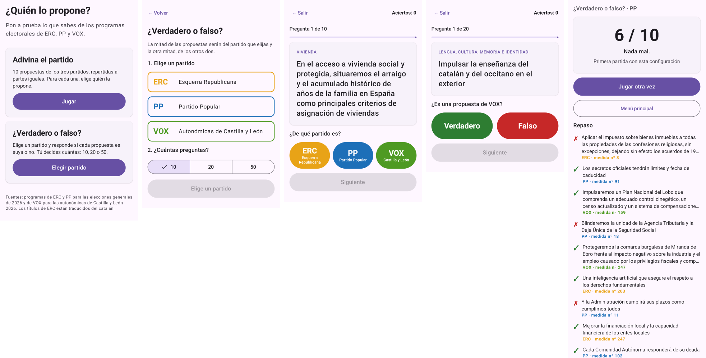
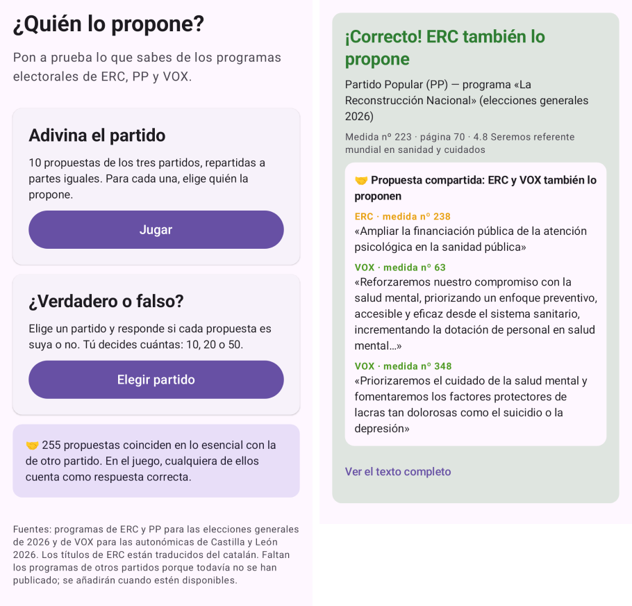
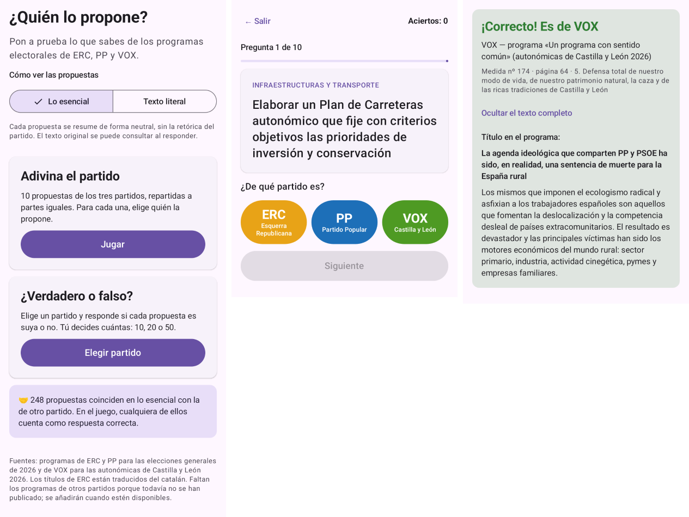

# ¿Quién lo propone?

App Android (Kotlin + Jetpack Compose) para jugar a adivinar de qué partido es cada propuesta electoral. Incluye 966 iniciativas:

- **ERC** y **PP**: programas de las elecciones generales de 2026. Son 468 medidas: las 476 del inventario menos las 8 del PP marcadas como «por anunciar».
- **VOX**: programa de las elecciones autonómicas de Castilla y León (marzo de 2026). Son 498 medidas: las 509 del programa menos 11 que el propio programa repite casi literalmente en otra sección.

Faltan los programas de otros partidos porque todavía no se han publicado. Se añadirán cuando estén disponibles.



## Modos de juego

**Adivina el partido.** 10 propuestas equilibradas: cada partido aparece 3 veces y la décima es de un partido al azar. Para cada propuesta se elige ERC, PP o VOX.

**¿Verdadero o falso?** Se elige un partido y el número de preguntas (10, 20 o 50). La mitad de las propuestas son de ese partido y la otra mitad de los otros dos, a partes iguales. Para cada una se responde si es de ese partido o no.

En los dos modos:

- Tras cada respuesta, la app dice de quién es la propuesta, con su número, página y sección del programa. «Ver el texto completo» muestra la descripción íntegra; en ERC, también el título original en catalán.
- Al final se muestra la puntuación, un repaso de todas las preguntas y el récord de esa configuración, que se guarda en el móvil.
- En una misma partida no se repite ninguna propuesta.

**Propuestas compartidas.** 248 propuestas coinciden en lo esencial con la de otro partido. Son 168 parejas revisadas una a una, por ejemplo la educación infantil de 0 a 3 años gratuita (ERC, PP y VOX), más recursos para la salud mental (ERC, PP y VOX) o el apoyo a Ucrania (ERC y PP). En el juego, cualquiera de los partidos que la proponen cuenta como acierto, y al responder la app muestra la propuesta equivalente del otro partido. Las propuestas solo «parecidas», sobre el mismo tema pero con medidas distintas, se muestran como información. El listado completo está en el inventario.



**Lo esencial / Texto literal.** En la pantalla de inicio se elige cómo ver las propuestas. La opción por defecto es «Lo esencial»: un resumen neutral de cada medida que cuenta qué se propone hacer, sin la retórica del partido y empezando siempre por un infinitivo («Hacer gratuita…», «Bajar…»), para que ni el estilo ni el tono delaten al partido. El título literal del programa se puede consultar al responder, con «Ver el texto completo». La otra opción, «Texto literal», muestra el título tal como aparece en el programa. Los resúmenes son una redacción propia y están también en el inventario, en la columna «Lo esencial».



Los títulos de ERC se muestran traducidos al castellano para que el idioma no delate al partido.

## Datos

`app/src/main/assets/iniciativas.json` se genera a partir de `../inventario/inventario_iniciativas_2026.xlsx`. Campos: `partido`, `n` (nº de medida), `pag`, `tema`, `seccion`, `titulo` (castellano), `original` (catalán, sólo ERC), `desc`, `esencial` (resumen neutral) y `compartida` (coincidencias con otros partidos).

## Compilar

Requiere JDK 17+ y el Android SDK (plataforma 35). Indica la ruta del SDK en `local.properties` (`sdk.dir=...`) o con `ANDROID_HOME`.

```bash
./gradlew assembleDebug
```

Pruebas del reparto equilibrado de preguntas:

```bash
./gradlew testDebugUnitTest
```

El APK queda en `app/build/outputs/apk/debug/app-debug.apk`. `./gradlew assembleRelease` genera un APK optimizado, firmado con la clave de depuración. Para publicarlo en Google Play hay que configurar una clave de firma propia.
