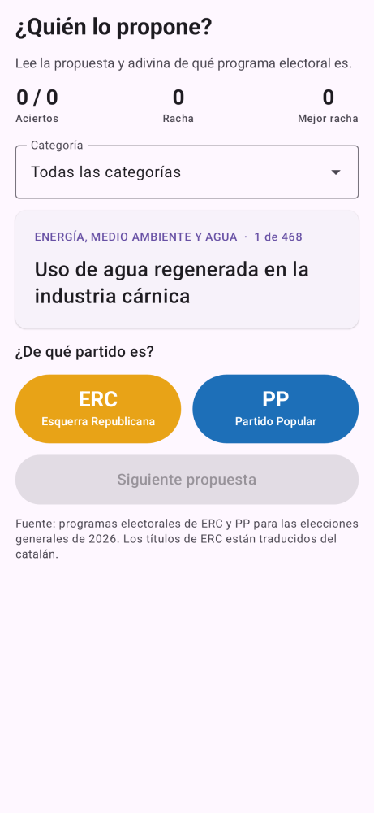
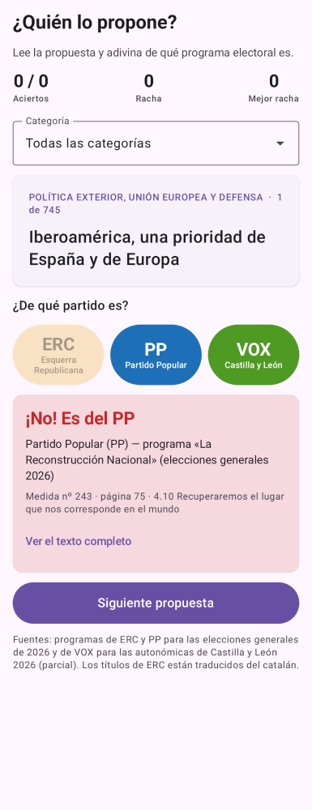

# ¿Quién lo propone?

App Android (Kotlin + Jetpack Compose) para jugar a adivinar de qué partido es cada propuesta electoral. Incluye 977 iniciativas:

- **ERC** y **PP**: programas de las elecciones generales de 2026. Son 468 medidas: las 476 del inventario menos las 8 del PP marcadas como «por anunciar».
- **VOX**: programa de las elecciones autonómicas de Castilla y León (marzo de 2026), completo, con sus 509 medidas.

 

## Cómo funciona

- Se muestra una propuesta al azar, sin indicar de qué partido es.
- El jugador pulsa **ERC**, **PP** o **VOX** y la app le dice si ha acertado y de quién es la medida, con su número, página y sección del programa.
- «Ver el texto completo» muestra la descripción íntegra (en ERC, también el título original en catalán).
- Se puede filtrar por categoría. Lleva la cuenta de aciertos y rachas, y guarda la mejor racha.
- Los títulos de ERC se muestran traducidos al castellano para que el idioma no delate al partido.

## Datos

`app/src/main/assets/iniciativas.json` se genera a partir de `../inventario/inventario_iniciativas_2026.xlsx`. Campos: `partido`, `n` (nº de medida), `pag`, `tema`, `seccion`, `titulo` (castellano), `original` (catalán, sólo ERC) y `desc`.

## Compilar

Requiere JDK 17+ y el Android SDK (plataforma 35). Indica la ruta del SDK en `local.properties` (`sdk.dir=...`) o con `ANDROID_HOME`.

```bash
./gradlew assembleDebug
```

El APK queda en `app/build/outputs/apk/debug/app-debug.apk`. `./gradlew assembleRelease` genera un APK optimizado, firmado con la clave de depuración. Para publicarlo en Google Play hay que configurar una clave de firma propia.
