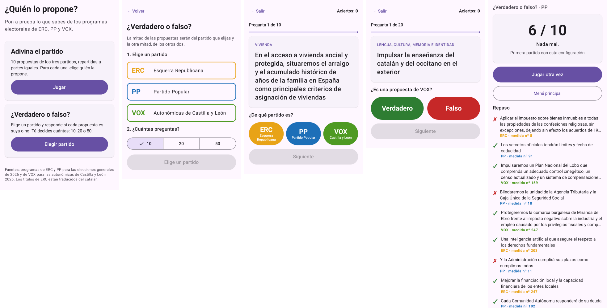
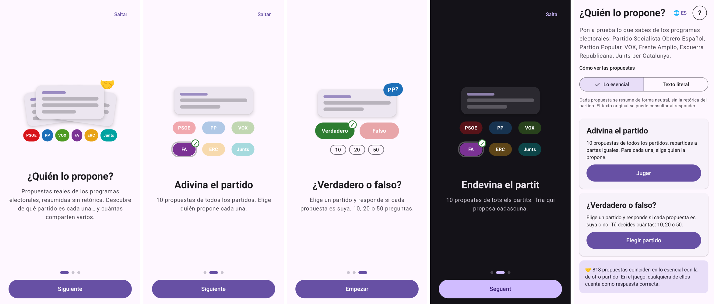
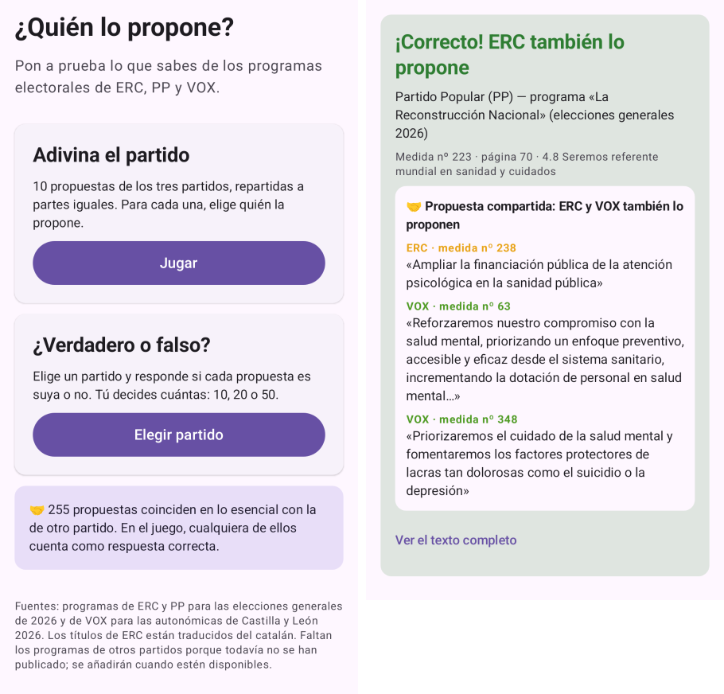
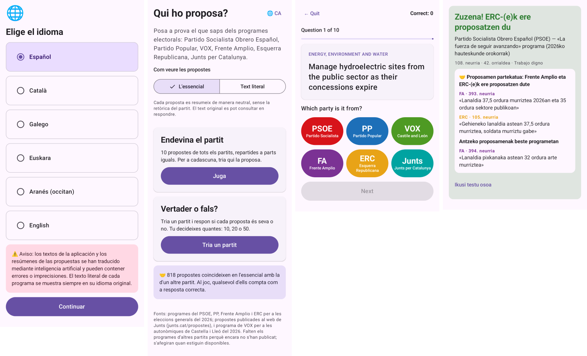
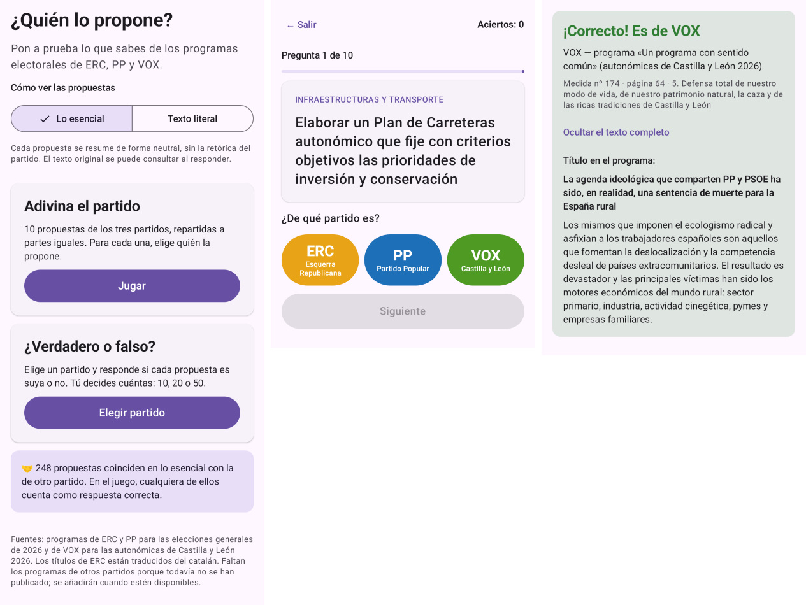

# ¿Quién lo propone?

App Android (Kotlin + Jetpack Compose) para jugar a adivinar de qué partido es cada propuesta electoral. Incluye 2.495 propuestas de seis partidos:

| Partido | Fuente | Propuestas |
|---|---|--:|
| PSOE | Programa «La fuerza de seguir avanzando», generales 2026 | 500 |
| PP | Programa «La Reconstrucción Nacional», generales 2026 (sin los 8 huecos «por anunciar») | 241 |
| VOX | Programa de las autonómicas de Castilla y León, marzo de 2026 (sin 11 medidas que el programa repite) | 498 |
| Frente Amplio | Programa electoral, generales 2026 (viñetas numeradas en orden, el programa no numera) | 967 |
| ERC | Programa «Pel país. Per la gent. Pel futur.», generales 2026 | 227 |
| Junts | Propuestas de su web, junts.cat/propostes (no ha publicado programa en PDF) | 62 |

Faltan los programas de otros partidos porque todavía no se han publicado. Se añadirán cuando estén disponibles.



## Bienvenida

La primera vez que se abre la app, después de elegir el idioma, tres pantallas explican de qué va: qué es la app y cómo funciona cada modo de juego, cada una con una ilustración y poco texto. Se pueden saltar y se vuelven a abrir con el botón **?** de la pantalla de inicio.



## Modos de juego

**Adivina el partido.** 10 propuestas equilibradas: cada partido aparece una vez y las cuatro restantes son de partidos al azar, sin que ninguno salga más de dos veces. Para cada propuesta se elige entre los seis partidos.

**¿Verdadero o falso?** Se elige un partido y el número de preguntas (10, 20 o 50). La mitad de las propuestas son de ese partido y la otra mitad del resto de partidos, a partes iguales. Para cada una se responde si es de ese partido o no.

En los dos modos:

- Al responder, cada botón muestra su estado: tu elección correcta lleva ✓ y un aro fijo; si fallas, tu elección queda atenuada, tachada y con ✕; las opciones correctas que no elegiste llevan ✓ y un aro que late. Así se distingue un fallo de una propuesta compartida.

- Tras cada respuesta, la app dice de quién es la propuesta, con su número, página y sección del programa. «Ver el texto completo» muestra la descripción íntegra; en ERC, también el título original en catalán.
- Al final se muestra la puntuación, un repaso de todas las preguntas y el récord de esa configuración, que se guarda en el móvil.
- En una misma partida no se repite ninguna propuesta.

**Propuestas compartidas.** 818 propuestas coinciden en lo esencial con la de otro partido: por ejemplo, la educación infantil de 0 a 3 años gratuita, la jornada de 37,5 horas (PSOE, Frente Amplio y ERC) o reducir las listas de espera. En el juego, cualquiera de los partidos que la proponen cuenta como acierto, y al responder la app muestra la propuesta equivalente del otro partido. Las propuestas solo «parecidas», sobre el mismo tema pero con medidas distintas, se muestran como información. El listado completo está en el inventario.



**Idiomas.** Al abrir la app por primera vez se elige el idioma: español, català, galego, euskara, aranés (occitano) o inglés. Se puede cambiar después con el botón 🌐 de la pantalla de inicio. La interfaz y «lo esencial» de cada propuesta están traducidos con inteligencia artificial, y la app lo advierte. El texto literal de los programas se muestra siempre en su idioma original.



**Lo esencial / Texto literal.** En la pantalla de inicio se elige cómo ver las propuestas. La opción por defecto es «Lo esencial»: un resumen neutral de cada medida que cuenta qué se propone hacer, sin la retórica del partido y empezando siempre por un infinitivo («Hacer gratuita…», «Bajar…»), para que ni el estilo ni el tono delaten al partido. El título literal del programa se puede consultar al responder, con «Ver el texto completo». La otra opción, «Texto literal», muestra el título tal como aparece en el programa. Los resúmenes son una redacción propia y están también en el inventario, en la columna «Lo esencial».



Los títulos de ERC y Junts se muestran traducidos al castellano para que el idioma no delate al partido. Las traducciones de «lo esencial» están en `assets/esencial_<idioma>.json`.

## Datos

`app/src/main/assets/iniciativas.json` se genera a partir de `../inventario/inventario_iniciativas_2026.xlsx`. Campos: `partido`, `n` (nº de medida), `pag`, `tema`, `seccion`, `titulo` (castellano), `original` (catalán, sólo ERC y Junts), `desc`, `esencial` (resumen neutral) y `compartida` (coincidencias con otros partidos).

## Compilar

Requiere JDK 17+ y el Android SDK (plataforma 35). Indica la ruta del SDK en `local.properties` (`sdk.dir=...`) o con `ANDROID_HOME`.

```bash
./gradlew assembleDebug
```

Pruebas del reparto equilibrado de preguntas:

```bash
./gradlew testDebugUnitTest
```

El APK queda en `app/build/outputs/apk/debug/app-debug.apk`. `./gradlew assembleRelease` genera un APK optimizado, firmado con la clave de depuración. Para publicarlo en Google Play hay que configurar una clave de firma propia.
